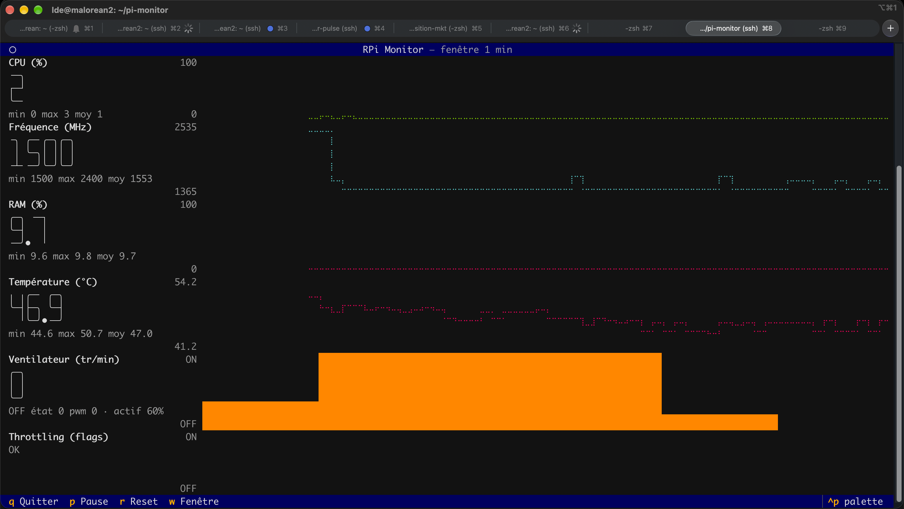

# rpi-monitor

Dashboard TUI (Textual) de monitoring Raspberry Pi 5, en lecture seule, sans sudo.

7 lignes empilées : valeur actuelle en gros à gauche (+ min/max/moyenne), courbe temporelle à droite.

De haut en bas :

1. **CPU (%)** : charge globale.
2. **Fréquence (MHz)** : fréquence actuelle du processeur.
3. **Consommation (W)** : puissance estimée (somme tension × courant des rails du PMIC, via `vcgencmd pmic_read_adc`).
4. **RAM (%)** : mémoire utilisée.
5. **Température (°C)** : température CPU.
6. **Ventilateur** : histogramme par périodes de 10 s (une activation d'une seconde est conservée).
7. **Throttling** : sous-tension, fréquence bridée, throttle, limite de température (histogramme par périodes de 10 s).



## Lancement

```
uv sync
uv run python app.py          # sur le Pi
uv run python app.py --demo   # données synthétiques (automatique hors Linux)
uv run pytest                 # tests
```

Touches : `q` quitter · `p` pause de l'affichage (la collecte continue) · `r` reset historique · `w` fenêtre 1 / 5 / 30 min.

## Architecture

- `rpimon/collectors.py` : lecture des capteurs (hwmon détecté par nom, pas par numéro).
- `rpimon/history.py` : buffers circulaires (30 min) et agrégation 10 s du ventilateur.
- `rpimon/monitor.py` : thread de collecte (ventilateur 500 ms, reste 1 s), indépendant de l'UI.
- `rpimon/widgets.py` + `app.py` : rendu.

Ventilateur « actif » = `cur_state > 0` ou `pwm1 > 0` ou `fan1_input > 0`.
Ajouter une métrique : une méthode de capteur, une série dans `Monitor.series`, un `Spec` dans `app.py`.
